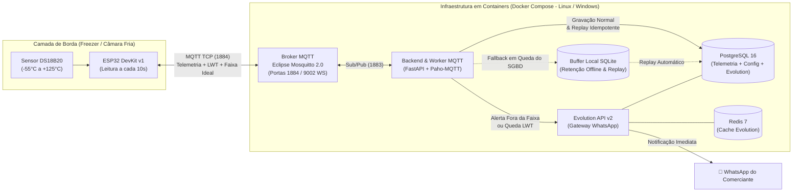

# ❄️ Sistema Coutos Conveniência — Monitoramento Térmico Resiliente com IoT, MQTT e Alertas WhatsApp

Sistema de monitoramento térmico contínuo, detecção de quedas de energia via **Last Will and Testament (LWT)** e notificação ativa via **WhatsApp (Evolution API)** para freezers e câmaras frigoríficas no pequeno varejo.

O projeto combina um nó de borda baseado em **ESP32 + Sensor Dallas DS18B20** com uma arquitetura em **Docker Compose** 100% intercambiável entre **Linux e Windows**, dotada de bufferização local tolerante a falhas e *replay* idempotente para o banco de dados **PostgreSQL**.

---

## 🏗️ Arquitetura do Sistema



---

## 📂 Estrutura do Repositório

```text
projeto_extensao/
├── .env.example                       # Template seguro de variáveis de ambiente
├── .gitattributes                     # Garante quebras de linha LF entre Windows e Linux
├── .gitignore                         # Protege credenciais (.env, secrets.h) e docs privados
├── docker-compose.yml                 # Orquestração completa (Mosquitto, Postgres, Redis, Evolution, Backend)
├── mosquitto/
│   └── config/mosquitto.conf          # Configuração do Broker MQTT com persistência e WebSockets
├── postgres/
│   └── init/01-init-evolution-db.sql  # Criação automática do banco para a Evolution API
├── backend/
│   ├── Dockerfile                     # Container Python 3.12 (FastAPI + Worker MQTT)
│   ├── requirements.txt               # Dependências do backend
│   └── app/
│       ├── main.py                    # Inicialização da API, Worker MQTT e Task de Replay
│       ├── config.py                  # Validação de configurações via Pydantic Settings
│       ├── database.py                # Sessão SQLAlchemy e healthcheck do PostgreSQL
│       ├── models.py                  # Tabelas: devices, telemetry_logs, alert_logs
│       ├── schemas.py                 # Contratos de entrada/saída da API REST
│       ├── buffer.py                  # Buffer local SQLite (WAL) e replay idempotente
│       ├── notifier.py                # Integração com a Evolution API (WhatsApp)
│       ├── mqtt_service.py            # Assinatura MQTT, avaliação de faixa térmica e LWT
│       └── api/routes.py              # Endpoints REST para configuração, telemetria e alertas
├── firmware/
│   └── esp32_freezer_monitor/
│       ├── platformio.ini             # Configuração para VS Code / PlatformIO
│       ├── secrets.example.h          # Template seguro para credenciais Wi-Fi/MQTT da placa
│       ├── esp32_freezer_monitor.ino  # Firmware C++ do ESP32 (DS18B20 + MQTT/LWT)
│       └── README.md                  # Esquema de pinagem e instruções de gravação
└── scripts/
    └── simulate_esp32.py              # Simulador de telemetria, anomalias térmicas e LWT
```

---

## 📋 Mapa de Tópicos MQTT

| Tópico | Direção | QoS / Retain | Descrição |
| :--- | :--- | :---: | :--- |
| `loja/freezer/<id>/telemetry` | ESP32 ➔ Broker | QoS 0/1 | JSON com `temperature_c`, `min_temp_c`, `max_temp_c`, `event_id` a cada 10s |
| `loja/freezer/<id>/status` | ESP32 ➔ Broker | QoS 1 / Retain | Presença do dispositivo (`online` ou `offline` via LWT) |
| `loja/freezer/<id>/config/set` | Backend ➔ ESP32 | QoS 1 / Retain | Sincroniza a faixa ideal (`min_temp_c`, `max_temp_c`) definida pelo usuário |


  A parte do relé em paralelo foi totalmente removida do código, banco de dados, API e firmware, e todos os 5 contêineres Docker já estão rodando e testados!

  Abaixo está a explicação detalhada da arquitetura, do fluxo de ponta a ponta, o resultado dos testes e o passo a passo para gravar o firmware no ESP32.
  ──────
  ## 1. Arquitetura e Fluxo Detalhado do Projeto

  O sistema é dividido em 4 camadas desacopladas que se comunicam de forma assíncrona:

    ┌────────────────┐  ┌───────────────┐
┌─────────────────────────┐┌───────────────────────────────────┐┌───────────────────────────┐┌───────────────────┐┌──────────────────────────┐
    │ Sensor DS18B20 │  │ ESP32 (Borda) │  │ Broker Mosquitto (MQTT) ││ Backend Python (FastAPI + Worker) ││ Buffer Local (SQLite WAL) ││ PostgreSQL (SGBD) ││ Evolution API (WhatsApp)
│
    └────────────────┘  └───────────────┘
└─────────────────────────┘└───────────────────────────────────┘└───────────────────────────┘└───────────────────┘└──────────────────────────┘
   ┤ loop A cada 10 segundos ├
             │                  │                       │                               │                                │                        │                        │
             │Leitura digital vi► OneWire (°C)          │                               │                                │                        │                        │
             │                  │                       │                               │                                │                        │                        │
             │                  │PUB loja/freezer/camara►1/telemetry (JSON)             │                                │                        │                        │
             │                  │                       │                               │                                │                        │                        │
             │                  │                       │Entrega mensagem ao Worker insc►ito                             │                        │                        │
             │                  │                       │                               │                                │                        │                        │
             │                  │                       │                               │ Compara temp com faixa ideal [min_temp_c, max_temp_c] ─┐│                        │
             │                  │                       │                               │◄─┘                             │                        │                        │
   ┤ alt Temperatura Fora da Faixa (Abaixo de Min ou Acima de Max) ├
             │                  │                       │                               │                                │                        │                        │
             │                  │                       │                               │──────────────────────POST /message/sendText/coutos_alertas───────────────────────►
             │                  │                       │                               │                                │                        │                        │
             │                  │                       │                               ◄┈┈┈┈┈┈┈┈┈┈┈┈┈┈Envia WhatsApp ao Comerciante (respeitando Cooldown)┈┈┈┈┈┈┈┈┈┈┈┈┈┈┈┈│
             │                  │                       │                               │                                │                        │                        │
             │                  │                       │                               │─────────────Registra alerta em alert_logs───────────────►                        │
   ┤ alt PostgreSQL Online ├
             │                  │                       │                               │                                │                        │                        │
             │                  │                       │                               │Grava leitura em telemetry_logs (Idempotente por event_id►                        │
             │                  │                       │                               │                                │                        │                        │
             │                  │                       │                               │Retém leitura em disco (buffered►telemetry)              │                        │
             │                  │                       │                               │                                │                        │                        │
             │                  │                       │                               │                                │Replay automático em lot► quando o banco volta   │
             │                  │                       │                               │                                │                        │                        │

  ### Como funciona cada etapa do fluxo:

  1. Camada de Borda (firmware/esp32_freezer_monitor/):
      • O ESP32 lê o sensor submersível Dallas DS18B20 no pino GPIO 4 a cada 10 segundos (readFreezerTemperatureC).
      • Ao conectar no Broker MQTT (reconnectMQTT), ele configura o LWT (Last Will and Testament) no tópico loja/freezer/camara01/status com keep-alive de 15 segundos. Se faltar luz
      no freezer ou o ESP32 desligar abruptamente, o próprio Mosquitto publica "offline" automaticamente.
      • A cada ciclo de 10s, o ESP32 publica um pacote JSON único (event_id, device_id, temperature_c, min_temp_c, max_temp_c, uptime_s) no tópico loja/freezer/camara01/telemetry.
  2. Camada de Mensageria (mosquitto/):
      • O contêiner coutos_mosquitto (mosquitto.conf) expõe a porta 1884 (TCP) na sua máquina para receber os dados do ESP32 via Wi-Fi e a porta 9002 (WebSockets) para a futura
      interface web.
  3. Camada de Processamento, Avaliação de Faixa e Resiliência (backend/):
      • O serviço MQTTTelemetryService em mqtt_service.py escuta todos os freezers (loja/freezer/+/telemetry e loja/freezer/+/status).
      • Avaliação da Faixa Ideal (_evaluate_thermal_alert):
          • Consulta a faixa definida pelo usuário (min_temp_c e max_temp_c) para aquele equipamento.
          • Se temperature_c < min_temp_c (gera alerta TEMP_BELOW_MIN) ou temperature_c > max_temp_c (gera alerta TEMP_ABOVE_MAX), aciona o WhatsAppNotifier.
          • Possui proteção de Cooldown (alert_cooldown_seconds, padrão 300s / 5 min): envia o primeiro alerta imediatamente e aguarda o tempo de cooldown antes de repetir, evitando
          flood no WhatsApp do comerciante a cada 10 segundos. Quando a temperatura volta para a faixa ideal, envia um aviso de Temperatura Normalizada (TEMP_NORMALIZED).
      • Tolerância a Falhas e Replay (LocalResilientBuffer):
          • Se o banco PostgreSQL estiver indisponível no momento da leitura, o backend salva a leitura localmente em SQLite (offline_buffer.sqlite3) e a tarefa assíncrona
          periodic_buffer_replay_task reenvia os dados automaticamente (ON CONFLICT (event_id) DO NOTHING) assim que o PostgreSQL volta.

  4. Camada de Notificação WhatsApp (evolution_api):
      • O contêiner coutos_evolution_api roda a Evolution API v2 na porta 8081 conectada ao coutos_redis e ao banco evolution_db no coutos_postgres.

  ──────
  ## 2. Status dos Contêineres e Testes Realizados

  Todos os 5 contêineres estão ativos no Docker:

  • coutos_mosquitto: Porta 1884 (MQTT TCP) e 9002 (MQTT WebSockets)
  • coutos_postgres: Porta 5433 no host -> 5432 no container (ajustada para 5433 pois seu Linux já tinha um Postgres local ocupando a 5432)
  • coutos_redis: Porta interna 6379 (Healthy)
  • coutos_evolution_api: http://localhost:8081 (Painel Manager em http://localhost:8081/manager)
  • coutos_backend: http://localhost:8000/docs (Swagger UI da API)

  Teste executado agora nos contêineres:

  1. Enviamos uma leitura simulada de -3.5 °C (dentro da faixa padrão de -10 °C a +5 °C) → Gravada no PostgreSQL com "is_out_of_range": false.
  2. Enviamos uma leitura simulada de -14.5 °C (abaixo da faixa ideal de -10 °C) → Gravada com "is_out_of_range": true, gerou automaticamente o registro em alert_logs com tipo
  "TEMP_BELOW_MIN" e disparou a chamada para a Evolution API!

  Você pode conferir no terminal ou navegador:

  • Leituras gravadas: http://localhost:8000/api/v1/telemetry
  • Alertas gerados: http://localhost:8000/api/v1/alerts
  • Alterar a faixa ideal de temperatura pelo Swagger: http://localhost:8000/docs (endpoint PATCH /api/v1/devices/{device_id}/thresholds)
  ──────
  ## 3. Como Enviar o /firmware para o ESP32

  O código do ESP32 está em esp32_freezer_monitor.ino. Siga estes 3 passos para gravá-lo na placa:

  ### Passo 1: Descobrir o IP da sua máquina na rede Wi-Fi

  O ESP32 precisa saber o IP do computador onde o Docker está rodando. No seu terminal Linux, rode:

    hostname -I | awk '{print $1}'

  (No Windows, seria ipconfig no PowerShell procurando por "Endereço IPv4", ex: 192.168.1.188).

  ### Passo 2: Criar o arquivo secrets.h (protegido pelo .gitignore)

  Entre na pasta do firmware, copie o arquivo de exemplo secrets.example.h para secrets.h e coloque o nome/senha do seu Wi-Fi e o IP obtido no Passo 1:

    cd /home/joao/projetos/projeto_extensao/firmware/esp32_freezer_monitor
    cp secrets.example.h secrets.h

  Edite o arquivo secrets.h:

    #define WIFI_SSID         "NOME_DO_SEU_WIFI"
    #define WIFI_PASSWORD     "SENHA_DO_SEU_WIFI"
    #define MQTT_BROKER_IP    "192.168.1.XXX" // <-- IP do seu computador na rede local
    #define MQTT_BROKER_PORT  1884            // Porta exposta pelo container coutos_mosquitto
    #define MQTT_USERNAME     ""
    #define MQTT_PASSWORD     ""
    #define DEVICE_ID         "camara01"

  ### Passo 3: Compilar e Gravar na Placa (Escolha Arduino IDE ou PlatformIO)

  #### Opção A — Usando Arduino IDE (Mais simples)

  1. Conecte o ESP32 na porta USB do computador.
  2. Abra a Arduino IDE e abra o arquivo /home/joao/projetos/projeto_extensao/firmware/esp32_freezer_monitor/esp32_freezer_monitor.ino.
  3. Em Ferramentas > Placa, selecione ESP32 Arduino > DOIT ESP32 DEVKIT V1 (ou ESP32 Dev Module).
  4. Em Gerenciador de Bibliotecas (ícone de livros na barra lateral), instale as 3 bibliotecas abaixo (se ainda não tiver):
      • PubSubClient (por Nick O'Leary)
      • OneWire (por Paul Stoffregen)
      • DallasTemperature (por Miles Burton)
  5. Em Ferramentas > Porta, selecione a porta USB do ESP32 (no Linux geralmente /dev/ttyUSB0 ou /dev/ttyACM0; no Windows COM3, COM4, etc.).
  6. Clique no botão Upload (Seta para a direita →) e abra o Monitor Serial em 115200 baud para ver o ESP32 conectando ao Wi-Fi e publicando no Mosquitto a cada 10 segundos!
  │ Dica: Mesmo se o sensor DS18B20 ainda não estiver ligado no pino GPIO 4, o firmware possui a flag SIMULATE_SENSOR_IF_DISCONNECTED = true (linha 29), então o seu ESP32 real já
  vai
  │ publicar temperaturas de teste no Docker imediatamente!


  #### Opção B — Usando VS Code + PlatformIO (Linha de comando ou Extensão)

  Como já deixei o arquivo platformio.ini configurado com todas as bibliotecas, basta abrir a pasta firmware/esp32_freezer_monitor no PlatformIO ou rodar:

    cd /home/joao/projetos/projeto_extensao/firmware/esp32_freezer_monitor
    pio run --target upload
    pio device monitor

