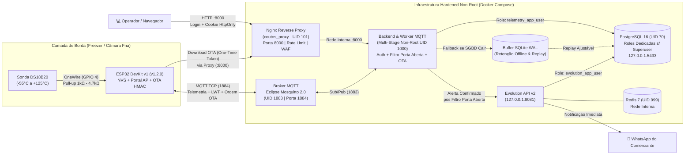

# ❄️ Sistema Coutos Conveniência — Monitoramento Térmico Resiliente (IoT, MQTT, OTA Seguro & WhatsApp)

Sistema de monitoramento térmico contínuo em tempo real, detecção imediata de quedas de energia/conexão via **Last Will and Testament (LWT)**, **Filtro Inteligente de Porta Aberta/Reposição**, **Atualização Remota de Firmware (OTA Seguro via HMAC-SHA256)** e notificação ativa via **WhatsApp (Evolution API)** para freezers e câmaras frigoríficas comerciais.

O projeto integra um nó de borda físico baseado em **ESP32 + Sonda Submersível Dallas DS18B20** (com Portal Cativo Wi-Fi próprio e memória persistente NVS) a uma infraestrutura em **Docker Compose Hardened** (containers *non-root*, build *multi-stage*, usuários dedicados de menor privilégio no PostgreSQL, Proxy Reverso Nginx e autenticação por senha), pronta tanto para uso local quanto para deploy gratuito na **Oracle Cloud Infrastructure (OCI Always Free — Ampere A1 ARM64)**.

---

## 📑 Índice

1. [Arquitetura e Fluxo do Sistema](#-1-arquitetura-e-fluxo-do-sistema)
2. [Camadas de Segurança e Hardening (Produção)](#-2-camadas-de-segurança-e-hardening-produção)
3. [Tutorial Passo a Passo: Uso Local e Configuração](#-3-tutorial-passo-a-passo-uso-local-e-configuração)
   - [Passo 1: Configurar Variáveis de Ambiente (.env)](#passo-1-configurar-variáveis-de-ambiente-env)
   - [Passo 2: Subir os Contêineres Docker Hardened](#passo-2-subir-os-contêineres-docker-hardened)
   - [Passo 3: Acessar o Painel Web com Senha e Configurar Faixa/Tempos](#passo-3-acessar-o-painel-web-com-senha-e-configurar-faixatempos)
   - [Passo 4: Montar o ESP32 + Sensor DS18B20 e Configurar o Wi-Fi](#passo-4-montar-o-esp32--sensor-ds18b20-e-configurar-o-wi-fi)
   - [Passo 5: Conectar o WhatsApp na Evolution API pelo Próprio Painel](#passo-5-conectar-o-whatsapp-na-evolution-api-pelo-próprio-painel)
   - [Passo 6: Atualização Remota de Firmware (OTA Seguro sem Cabo USB)](#passo-6-atualização-remota-de-firmware-ota-seguro-sem-cabo-usb)
4. [Deploy Completo na Oracle Cloud Always Free (OCI ARM64)](#-4-deploy-completo-na-oracle-cloud-always-free-oci-arm64)
5. [Comandos Úteis (Makefile e Docker CLI)](#-5-comandos-úteis-makefile-e-docker-cli)
6. [Referência da API REST e Tópicos MQTT](#-6-referência-da-api-rest-e-tópicos-mqtt)
7. [Troubleshooting (Solução de Problemas Comuns)](#-7-troubleshooting-solução-de-problemas-comuns)

---

## 🏗️ 1. Arquitetura e Fluxo do Sistema



---

## 🔐 2. Camadas de Segurança e Hardening (Produção)

1. **Contêineres Non-Root e Isolamento de Privilégios (`no-new-privileges`)**:
   - **`coutos_proxy` (`nginxinc/nginx-unprivileged:1.27-alpine`)**: Executa como usuário não privilegiado **`UID 101:101`** com sistema de arquivos raiz somente leitura (`read_only: true`) e `cap_drop: ["ALL"]`.
   - **`coutos_backend`**: Construído em **Multi-Stage Build** ([`backend/Dockerfile`](./backend/Dockerfile)) com ambiente virtual pré-compilado (`/opt/venv`) e executado sob o usuário **`nonroot` (`UID 1000:1000`, shell `/usr/sbin/nologin`)**, `cap_drop: ["ALL"]` e `no-new-privileges:true`, sem porta exposta diretamente no host (acessível apenas via `coutos_proxy`).
   - **`coutos_mosquitto`**, **`coutos_postgres`** e **`coutos_redis`**: Executam sob seus usuários dedicados não-root (`1883:1883`, `70:70` e `999:999`) com `no-new-privileges:true`.
   - **Portas de Banco e Gateway Restritas ao Loopback (`127.0.0.1`)**: O PostgreSQL (`127.0.0.1:5433`) e a Evolution API (`127.0.0.1:8081`) jamais ficam abertos na internet pública ao subir em uma VPS.

2. **Usuários Dedicados no Banco de Dados (Princípio do Menor Privilégio)**:
   - Configurados em [`postgres/init/01-init-evolution-db.sql`](./postgres/init/01-init-evolution-db.sql) e garantidos de forma idempotente no bootstrap ([`backend/app/main.py`](./backend/app/main.py)):
     - **`telemetry_app_user`**: Role sem privilégios `SUPERUSER`, `CREATEDB` ou `CREATEROLE`, com permissão restrita exclusivamente às tabelas do banco `coutos_telemetria`.
     - **`evolution_app_user`**: Role sem privilégios `SUPERUSER`, restrita exclusivamente ao banco `evolution_db`.

3. **Senha de Acesso ao Painel Web e API (`DASHBOARD_USERNAME` / `DASHBOARD_PASSWORD`)**:
   - O painel web (`http://localhost:8000`) exibe uma tela de login obrigatória e emite um **Cookie `HttpOnly; SameSite=Strict`** assinado criptograficamente via `HMAC-SHA256` ([`backend/app/auth.py`](./backend/app/auth.py)).
   - Todas as rotas `/api/v1/*` e `/docs` exigem sessão autenticada, cabeçalho `X-API-Key` ou HTTP Basic Auth, com *Rate Limiting* (`5 req/s`) no Nginx contra ataques de força bruta.

4. **Bloqueio de Arquivos Sensíveis em Dupla Camada (Nginx + FastAPI Middleware)**:
   - Tanto o [`nginx/nginx.conf`](./nginx/nginx.conf) quanto o [`SecurityAndAuthMiddleware`](./backend/app/auth.py) bloqueiam imediatamente com **`403 Forbidden`** qualquer tentativa de acesso a arquivos ocultos ou internos (`/.env`, `/.git`, `/secrets.h`, `*.sqlite3`, `*.db`, `*.sql`, `*.py`, `*.yml`, `*.conf`, `/data/`, `/ota/`).

5. **OTA Remoto Seguro em 5 Camadas**:
   - **Zero portas abertas no ESP32** (*Pull-Only*), validação de **Magic Byte `0xE9`**, ordem MQTT assinada com **`HMAC-SHA256`**, link de download com **One-Time Token (256 bits, expira em 180s e invalida no 1º uso)** e verificação **`SHA-256` on-the-fly** na partição secundária antes de reiniciar.

---

## 🚀 3. Tutorial Passo a Passo: Uso Local e Configuração

### Passo 1: Configurar Variáveis de Ambiente (`.env`)

```bash
make setup
```

Edite o arquivo `.env` gerado na raiz do projeto para definir suas senhas de produção:
- **`DASHBOARD_USERNAME` e `DASHBOARD_PASSWORD`**: Usuário e senha solicitados ao abrir o Painel Web.
- **`POSTGRES_PASSWORD`, `POSTGRES_APP_PASSWORD` e `EVOLUTION_DB_PASSWORD`**: Senhas do admin e das roles dedicadas do PostgreSQL.
- **`API_SECRET_KEY` e `OTA_SHARED_SECRET`**: Chaves criptográficas para autenticação de API e assinatura `HMAC-SHA256` de atualizações OTA do ESP32 (a `OTA_SHARED_SECRET` deve ser igual à definida em `firmware/esp32_freezer_monitor/secrets.h`).

---

### Passo 2: Subir os Contêineres Docker Hardened

```bash
make up
make ps
make status
```

| Contêiner | Usuário (`UID:GID`) | Porta Exposta | Função |
| :--- | :---: | :---: | :--- |
| `coutos_proxy` | `101:101` (`nginx`) | `0.0.0.0:8000` | Proxy Reverso Hardened, WAF de arquivos sensíveis e Rate Limiting |
| `coutos_backend` | `1000:1000` (`nonroot`) | Interna (`8000`) | API FastAPI, Worker MQTT, Filtro de Porta Aberta, Replay e Gerenciador OTA |
| `coutos_mosquitto` | `1883:1883` (`mosquitto`) | `0.0.0.0:1884` | Broker MQTT 2.0 (Telemetria, LWT e Comandos OTA/Config) |
| `coutos_postgres` | `70:70` (`postgres`) | `127.0.0.1:5433` | PostgreSQL 16 com isolamento entre `telemetry_app_user` e `evolution_app_user` |
| `coutos_redis` | `999:999` (`redis`) | Interna (`6379`) | Cache de alta velocidade para a Evolution API |
| `coutos_evolution_api` | App User | `127.0.0.1:8081` | Gateway WhatsApp (Evolution API v2) |

---

### Passo 3: Acessar o Painel Web com Senha e Configurar Faixa/Tempos

1. Abra **`http://localhost:8000`** no navegador.
2. Digite o **Usuário** (padrão: `admin`) e a **Senha do Painel** (`DASHBOARD_PASSWORD` definida no `.env`).
3. No card **"Faixa Ideal, Filtro de Porta Aberta & Tempos"**, você pode ajustar em tempo real:
   - **Mínima Ideal (°C)** e **Máxima Ideal (°C)**: Limites térmicos do freezer (sincronizados via MQTT com o ESP32).
   - **Filtro de Porta Aberta / Reposição (s)**: Tempo contínuo (ex: `180s` = 3 minutos) que a temperatura precisa permanecer fora da faixa antes de disparar o 1º alerta no WhatsApp. Evita alarmes falsos durante abertura rápida de porta ou reposição de mercadorias (`0` = alerta imediato).
   - **Cooldown entre alertas repetidos (s)**: Intervalo mínimo entre notificações repetidas no WhatsApp (ex: `300s`).
   - **Intervalo de Leitura do ESP32 (s)**: Frequência com que o ESP32 lê a sonda DS18B20 e envia via MQTT (ex: `10s`, salvo na memória Flash NVS do ESP32).
   - **Tempo de Replay do Buffer Local (s)**: Ciclo de sincronização automática do buffer SQLite local para o PostgreSQL (ex: `10s`).

---

### Passo 4: Montar o ESP32 + Sensor DS18B20 e Configurar o Wi-Fi

```text
   [ESP32: Pino 3V3] ───┬─── [Fio VERMELHO da Sonda (VCC)]
                        │
                   [Resistor 1kΩ a 4.7kΩ]
                        │
   [ESP32: Pino D4 ] ───┴─── [Fio AMARELO da Sonda (DATA)]

   [ESP32: Pino GND] ─────── [Fio PRETO da Sonda (GND)]
```

1. Na primeira gravação via cabo USB, execute:
   ```bash
   make esp-upload
   ```
2. **Como trocar o Wi-Fi ou o IP do servidor no ESP32 sem reprogramar**:
   - **Pelo Painel Web Central (`http://localhost:8000`)**: No card *"Configuração de Wi-Fi do Dispositivo (ESP32)"*, informe o novo SSID/Senha e clique em **Enviar Novo Wi-Fi ao ESP32**.
   - **Em Campo (Portal Cativo)**: Se o ESP32 for levado para outro cliente e não encontrar o Wi-Fi cadastrado (ou se você segurar o botão físico **`BOOT`** por 2 segundos), ele abre automaticamente a rede Wi-Fi **`Coutos-Freezer-Config`**. Conecte-se a ela pelo celular e acesse **`http://192.168.4.1`** para escolher a rede Wi-Fi da loja e salvar na memória Flash (NVS).

---

### Passo 5: Conectar o WhatsApp na Evolution API pelo Próprio Painel

1. No painel **`http://localhost:8000`**, role até **"Configuração do Gateway WhatsApp (Evolution API)"**.
2. Confira o número de destino em **WhatsApp de Destino (Comerciante)** (formato `5567999999999`) e clique em **Salvar Configurações**.
3. Ao lado direito, clique em **Conectar / Gerar QR Code** e escaneie o QR Code exibido na tela com o WhatsApp.
4. Clique em **Enviar Mensagem de Teste** (ou rode `make test-whatsapp` no terminal) para validar o recebimento.

---

### Passo 6: Atualização Remota de Firmware (OTA Seguro sem Cabo USB)

Após o primeiro upload via USB, todas as próximas atualizações podem ser feitas **100% pela rede**:

- **Via Terminal (1 comando)**:
  ```bash
  make esp-ota VERSION=1.2.0
  ```
- **Via Painel Web (`http://localhost:8000`)**:
  1. Gere o binário com `make esp-build-bin` (salvo em `firmware/esp32_freezer_monitor/build/esp32_freezer_monitor.ino.bin`).
  2. No card **"Atualização Remota de Firmware (OTA Seguro)"**, selecione o arquivo `.bin`, informe a versão e a chave `OTA_SHARED_SECRET`, e clique em **Assinar e Atualizar ESP32**.

---

## ☁️ 4. Deploy Completo na Oracle Cloud Always Free (OCI ARM64)

A stack completa é 100% compatível com a arquitetura **`linux/arm64`** das instâncias gratuitas vitalícias da **Oracle Cloud Infrastructure (OCI)**.

### 1. Criar a Instância na Oracle Cloud
1. No painel da OCI (região **São Paulo** ou **Vinhedo**), acesse **Compute > Instances > Create Instance**.
2. Em **Image and Shape**:
   - **Image**: *Canonical Ubuntu 24.04 Minimal aarch64* (ou Ubuntu 22.04 ARM64).
   - **Shape**: *Ampere* ➔ **`VM.Standard.A1.Flex`** com **2 a 4 OCPUs** e **12 GB a 24 GB de RAM** (dentro do limite *Always Free*).
3. Na **VCN Security List (Ingress Rules)** da Oracle Cloud, libere apenas as portas necessárias:
   - **TCP `22`**: SSH (administração).
   - **TCP `8000`**: Acesso ao Painel Web (protegido pelo `coutos_proxy` + Login com senha) e download OTA com One-Time Token.
   - **TCP `1884`**: Broker MQTT para os dispositivos ESP32 enviarem telemetria.
   - *(Não abra as portas `5433` nem `8081` — elas ficam restritas ao `127.0.0.1` interno da VM).*

### 2. Preparar a VM e Subir o Sistema
Conecte via SSH na VM da Oracle Cloud e execute:

```bash
# 1. Instalar Docker Engine, Docker Compose plugin e Make
sudo apt update && sudo apt install -y ca-certificates curl git make iptables-persistent
curl -fsSL https://get.docker.com | sudo sh
sudo usermod -aG docker $USER
newgrp docker

# 2. Clonar o repositório e preparar o .env de produção
git clone <URL_DO_SEU_REPOSITORIO> projeto_extensao
cd projeto_extensao
make setup

# 3. Editar o .env trocando TODAS as senhas padrão por senhas fortes:
nano .env

# 4. Liberar as portas 8000 e 1884 no firewall interno (iptables) da imagem Ubuntu da Oracle:
make oracle-firewall

# 5. Construir a imagem multi-stage non-root e subir todos os 6 containers:
make up
```

---

## 🛠️ 5. Comandos Úteis (`Makefile` e Docker CLI)

Execute `make` (ou `make help`) na raiz do projeto para visualizar todos os atalhos:

| Comando `make` | O que faz |
| :--- | :--- |
| `make setup` | Cria `.env` e `secrets.h` a partir dos templates (sem sobrescrever se já existirem) e mostra o IP local |
| `make ip` | Exibe o(s) endereço(s) IP desta máquina na rede para configurar o ESP32 |
| `make up` | Constrói (multi-stage) e sobe todos os 6 contêineres em background |
| `make down` | Para e remove os contêineres preservando os volumes de dados |
| `make restart` | Reinicia todos os contêineres |
| `make ps` | Lista o status e mapeamento de portas dos contêineres |
| `make logs` | Acompanha os logs de todos os contêineres em tempo real |
| `make logs-backend` | Acompanha os logs do Backend FastAPI + Worker MQTT |
| `make logs-mqtt` | Acompanha os logs do Broker Mosquitto |
| `make logs-whatsapp` | Acompanha os logs da Evolution API |
| `make mqtt-watch` | Escuta ao vivo todos os pacotes MQTT em `loja/freezer/#` |
| `make status` | Consulta autenticada (`X-API-Key`) da saúde do PostgreSQL, MQTT e Buffer SQLite |
| `make devices` | Lista os freezers cadastrados, faixa ideal, filtro de porta aberta e versão de firmware |
| `make telemetry LIMIT=10` | Lista as últimas leituras de temperatura gravadas no PostgreSQL |
| `make alerts LIMIT=10` | Lista o histórico de alertas térmicos e de queda de energia (LWT) |
| `make set-range MIN=-8 MAX=2` | Atualiza a faixa ideal de temperatura e sincroniza com o ESP32 via MQTT |
| `make test-whatsapp` | Envia uma mensagem de teste via Evolution API para o WhatsApp configurado |
| `make db-shell` | Abre o terminal SQL (`psql`) conectado como o usuário dedicado `telemetry_app_user` |
| `make db-users` | Lista as roles do PostgreSQL confirmando ausência de privilégio `SUPERUSER` nos usuários de app |
| `make oracle-firewall` | Libera as portas `8000` e `1884` no `iptables` de VMs da Oracle Cloud (OCI) |
| `make esp-compile` | Compila o firmware do ESP32 para validar erros de sintaxe |
| `make esp-build-bin` | Compila e exporta o binário `.bin` pronto para OTA exibindo o hash `SHA-256` |
| `make esp-upload` | Compila e grava o firmware no ESP32 via cabo USB (`/dev/ttyUSB0`) |
| `make esp-ota VERSION=1.2.0` | Compila o `.bin` e dispara atualização OTA remota assinada (`HMAC-SHA256`) pela rede |
| `make esp-monitor` | Abre o monitor serial em `115200` baud desativando `DTR/RTS` (não trava o ESP32) |
| `make simulate` | Executa o simulador de telemetria normal em Python |
| `make simulate-alert` | Simula anomalia de temperatura alta para testar o filtro de porta aberta e alerta |
| `make simulate-lwt` | Simula queda abrupta de energia no ESP32 (teste de Last Will and Testament) |

---

## 📡 6. Referência da API REST e Tópicos MQTT

### Tópicos MQTT

| Tópico | Direção | QoS / Retain | Descrição |
| :--- | :--- | :---: | :--- |
| `loja/freezer/<id>/telemetry` | ESP32 ➔ Broker | QoS 0 | JSON com `temperature_c`, `fw_version`, `sensor_real`, `wifi_ssid`, `wifi_ip`, `wifi_rssi`, `uptime_s` |
| `loja/freezer/<id>/status` | ESP32 ➔ Broker | QoS 1 / Retain | Presença do dispositivo (`online` ao conectar; `offline` via LWT se cair energia/rede) |
| `loja/freezer/<id>/config/set` | Backend ➔ ESP32 | QoS 1 / Retain | Sincroniza `min_temp_c`, `max_temp_c`, `telemetry_interval_s`, Wi-Fi ou abertura do Portal AP |
| `loja/freezer/<id>/ota/trigger` | Backend ➔ ESP32 | QoS 1 / Sem Retain | Ordem OTA assinada com `HMAC-SHA256` (`version`, `token`, `size`, `sha256`, `sig`) |
| `loja/freezer/<id>/ota/status` | ESP32 ➔ Broker | QoS 0 | Progresso em tempo real do OTA (`starting`, `downloading`, `rebooting`, `failed`) |

---

## 🩺 7. Troubleshooting (Solução de Problemas Comuns)

### 1. Recebo `401 Unauthorized` ao chamar a API via `curl` ou navegador
- **Causa**: Todos os endpoints `/api/v1/*` agora são protegidos por autenticação.
- **Solução**:
  - **No navegador**: Acesse `http://localhost:8000` e faça login com `DASHBOARD_USERNAME` e `DASHBOARD_PASSWORD` definidos no `.env`.
  - **No terminal**: Use os atalhos do Makefile (`make status`, `make devices`, `make telemetry`) que já enviam o header `X-API-Key` automaticamente, ou passe `-H "X-API-Key: SUA_CHAVE_DO_ENV"` no `curl`.

---

### 2. Na Oracle Cloud, abri as portas no painel web da OCI (Security List), mas não consigo acessar `:8000` ou `:1884` externamente
- **Causa**: As imagens oficiais do Ubuntu na Oracle Cloud vêm com regras de `iptables` locais (`REJECT`) que bloqueiam portas além da 22, mesmo quando liberadas na Security List da VCN.
- **Solução**: Rode na VM da Oracle Cloud o comando incluído no projeto:
  ```bash
  make oracle-firewall
  ```

---

### 3. A temperatura saiu da faixa ideal, mas o WhatsApp ainda não apitou
- **Causa**: O **Filtro de Porta Aberta / Reposição (`alert_delay_seconds`)** está ativo (padrão: `180s` = 3 minutos). Enquanto o tempo contínuo fora da faixa for menor que esse valor, o painel exibe o badge amarelo **`Porta Aberta (Xs / 180s)`** e aguarda para evitar alarme falso.
- **Solução**: Se quiser testar o disparo imediato na bancada, altere o campo **"Filtro de Porta Aberta / Reposição (s)"** no painel web para **`0`** e clique em **Salvar Parâmetros**.

---

### 4. Falha na Atualização OTA (`Bloqueado: assinatura criptografica HMAC-SHA256 invalida!`)
- **Causa**: A chave `OTA_SHARED_SECRET` configurada no arquivo `.env` do servidor é diferente da constante `OTA_SHARED_SECRET` compilada no `secrets.h` do ESP32.
- **Solução**: Garanta que ambas tenham exatamente o mesmo valor antes de disparar o comando `make esp-ota` ou enviar o `.bin` pelo painel web.

---

### 5. O pacote MQTT chega com `"sensor_real": false` (Sonda DS18B20 não detectada)
- **Causa**: Falta de resistor de pull-up entre `D4` (`GPIO 4`) e `3V3` ou mau contato nos fios da sonda.
- **Solução**:
  1. Confira na protoboard se o resistor de **`1 kΩ` a `4,7 kΩ`** liga o pino **`D4` (Fio Amarelo)** ao pino **`3V3` (Fio Vermelho)**, e o **Fio Preto** está no **`GND`**.
  2. Rode `make mqtt-watch` e confirme `"sensor_real": true`.

---

### 6. O ESP32 foi levado para outra loja e não conecta no Wi-Fi novo
- **Causa**: O SSID salvo na memória NVS ainda é o da rede anterior.
- **Solução**: Segure o botão **`BOOT`** na placa ESP32 por **2 segundos** (ou aguarde 15 segundos ao ligá-lo sem a rede antiga por perto). O LED piscará 4 vezes e abrirá o Wi-Fi **`Coutos-Freezer-Config`**. Conecte-se a ele pelo celular, acesse **`http://192.168.4.1`**, clique em **Buscar Redes**, selecione o Wi-Fi 2.4 GHz da loja, digite a senha e clique em **Salvar e Conectar**.
